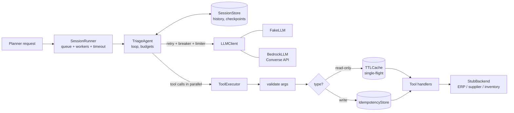
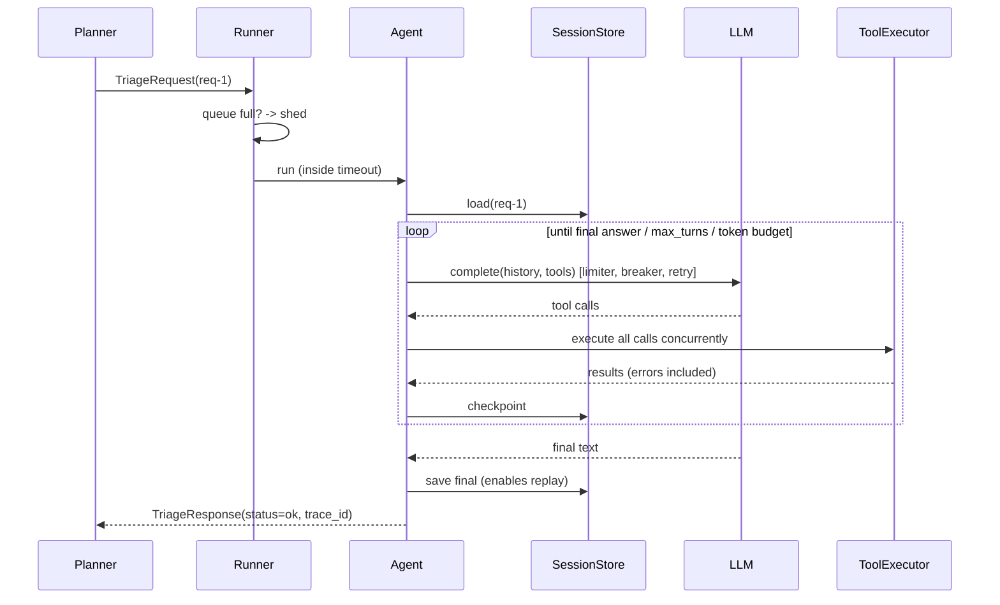
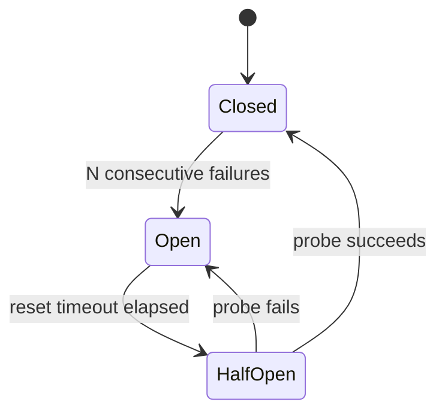

# ARCHITECTURE.md

## 1. Design principles

1. **Everything external is behind an interface** (`LLMClient`, `IdempotencyStore`, `SessionStore`, tools). Swap implementations, keep the logic.
2. **The agent is stateless.** All conversation state is local to one call or in the `SessionStore`.
3. **Errors are data.** Tools never raise into the loop; they return structured error results the model can reason about.
4. **Two kinds of failure.** `TransientError` (try again) vs `PermanentError` (never retry). Every layer speaks this vocabulary.
5. **Protect the dependency, then the caller.** Limit load going out (rate limiter, bulkheads, breaker) before worrying about handling errors coming back.

## 2. Component map



| Module | Responsibility |
|---|---|
| `runner.py` | Admission control: bounded queue, N worker slots, per-session timeout, load shedding. Never raises. |
| `agent.py` | The loop. Enforces `max_turns` and the token budget. Checkpoints after each tool round. |
| `llm/` | `LLMClient` protocol, `FakeLLM`, `BedrockLLM` (Converse mapping + error classification). |
| `tools/executor.py` | Validate -> (cache or idempotency) -> retry -> bulkhead -> structured result. Per-tool breaker, budget, bulkhead. |
| `tools/po_tools.py`, `stub_backend.py` | Tool schemas/handlers and the fake business systems with failure injection. |
| `retry.py` | Backoff with full jitter wrapped around limiter, breaker, budget and timeout. |
| `resilience.py` | `TokenBucket`, `CircuitBreaker`, `RetryBudget`. |
| `idempotency.py`, `cache.py`, `session_store.py` | State interfaces with in-memory implementations. |
| `logging.py`, `metrics.py` | JSON logs with context propagation; counters and timings. |

## 3. Life of one request



## 4. The retry stack for one LLM or tool call

Order matters; each guard protects against a different thing:

```
wait for rate-limit token      -> don't exceed the quota in the first place
breaker.allow()                -> don't call a service known to be down (fail fast)
 timeout( call )               -> don't wait forever
   success   -> breaker closes, return
   permanent -> raise immediately (dependency is up, request is bad)
   transient -> breaker.record_failure()
                attempts left?   no -> raise
                budget has token? no -> raise   (retry-storm brake)
                sleep random(0, min(cap, base * 2^attempt))   (full jitter)
                loop
```

Circuit breaker states:



## 5. Idempotency (the double-charge problem)

Key = `sha256(request_id | tool | canonical_json(args))[:32]`; the *same intent* always gets the *same key*, even if the model asks twice or the session is retried.

Two independent layers:
1. **Local store** (`run_once`): concurrent duplicates wait for the first run; later ones get the stored result. Failures are not stored.
2. **Backend ledger**: the key is passed to the backend, which dedupes server-side. This covers "the write succeeded but the reply was lost": the local store saw a failure and allows a retry, and the backend answers with the original result. A test covers exactly this.

## 6. Concurrency and load control

- One event loop, many sessions. I/O-bound work (LLM, tools) parallelises well with `asyncio`; blocking `boto3` calls go through `asyncio.to_thread`.
- `Semaphore(max_concurrent_sessions)` caps work in flight; up to `max_queue_depth` more may wait; beyond that requests are **shed** with `status="shed"`, which is faster and kinder than a timeout for everyone.
- Per-tool **bulkheads**: a slow inventory service can occupy only its own slots.
- Read-only lookups use a TTL cache with **single-flight**: 100 simultaneous misses cause one backend call.

## 7. State and isolation

`SessionState(messages, turns, tool_calls, tokens, final)` is loaded and saved by `request_id`. The store returns copies, as a network store would. Consequences: no cross-talk between sessions, resumable after timeout/crash, replay of finished requests, and any worker can continue any session once the store is shared.

## 8. Observability

- **Logs**: one JSON object per line; `request_id` and `trace_id` are attached automatically via a `ContextVar` (asyncio copies it into each task). Example:
  `{"ts":"...","level":"WARNING","logger":"po_agent.retry","event":"retry_scheduled","request_id":"req-3","trace_id":"9e53...","op":"tool:get_inventory","attempt":1,"delay_s":0.083}`
- **Metrics** (`METRICS.snapshot()`): `transient_error.<op>`, `retries.<op>`, `retry_budget_exhausted.<op>`, `circuit_opened.<name>`, `circuit_rejected.<name>`, `cache.hit|miss.<tool>`, `idempotent_replay.<tool>`, `session.<status>`, `token_budget_exhausted`, `rate_limiter.waits`; timings `llm_latency_s`, `tool_latency_s.<tool>`, `session_latency_s`, `queue_wait_s` (count/avg/p95/max).
- **Evals**: `tests/evals/cases.json` holds fixed scenarios with expected content and side-effect counts. Run them against the real model on a schedule and on every prompt/model change; track the pass rate.

## 8a. Bedrock adapter notes

Lessons baked into `llm/bedrock.py` (verified against a fake client and the real `botocore` config; **not** against live AWS):

- **Single retry layer.** boto3 retries throttling by default. `build_client` sets `total_max_attempts=1` so our backoff/jitter/budget/breaker are the only retries. (In botocore, `max_attempts=1` means one *retry*, i.e. two attempts; `total_max_attempts=1` is the unambiguous setting.)
- **Socket timeout below the asyncio timeout.** Cancelling an `await` does not stop the worker thread running `converse`; the socket `read_timeout` (18 s vs the 20 s `llm_timeout_s`) is what frees it.
- **Dedicated thread pool and connection pool.** The default asyncio executor is capped near `min(32, cpus + 4)` and shared; botocore's HTTP pool defaults to 10 connections. Both are sized by `max_concurrency` so real concurrency matches the semaphores.
- **`stopReason` is honoured.** `max_tokens` with a tool call raises (never execute truncated arguments); `max_tokens` with text returns `truncated=True` and the session ends `incomplete`; `guardrail_intervened` / `content_filtered` raise `PermanentError`.
- Not implemented: streaming (`converse_stream`), cross-region inference profiles, model fallback, prompt caching.

## 8b. Security controls

Full STRIDE analysis in [THREAT_MODEL.md](THREAT_MODEL.md). Where the controls sit:
`validate_request` (runner, before any work) -> per-principal quota -> agent (principal-scoped session key) -> `ToolExecutor`: schema validation -> `Authorizer` -> idempotency key including the principal -> execution -> `po_agent.audit` record for writes. Principle: assume the model can be fooled by text it reads, so enforce limits and permissions in code, outside the model.

## 9. Scaling to production (not built yet)

| Today (in-memory) | Production swap |
|---|---|
| `InMemorySessionStore` | DynamoDB (key `request_id`, TTL) or Redis |
| `InMemoryIdempotencyStore` | DynamoDB conditional put (`attribute_not_exists`) + TTL, or Redis `SET NX` |
| per-process `TokenBucket` / breaker / budget | Shared limiter (Redis), or divide the Bedrock quota by worker count; breaker state per instance is usually acceptable |
| bounded in-process queue | SQS in front of workers, with a dead-letter queue |
| `METRICS` dict | CloudWatch Embedded Metric Format / OpenTelemetry; `trace_id` -> X-Ray |
| `StubBackend` | Real clients behind the same method signatures |
| `FakeLLM` | `BedrockLLM`; add Bedrock guardrails, model fallback, prompt caching |

## 10. Design decisions and trade-offs

- **asyncio over threads**: workload is I/O-bound; thousands of waiting sessions cost almost nothing.
- **Fake LLM that reads the conversation** rather than canned strings: it exercises the same loop and state handling a real model does, deterministically.
- **No dependencies in the core**: easy to read for a learner; `structlog`, `tenacity` or `pybreaker` would be reasonable replacements later.
- **Errors as tool results**: lets the model say "inventory unknown" instead of the session failing.
- **Fail the retry, not the session, when the breaker is open**: the agent degrades with partial data. In the demo, a high failure rate can open the inventory breaker; the agent then declines to expedite because it cannot see stock. That is intended.
