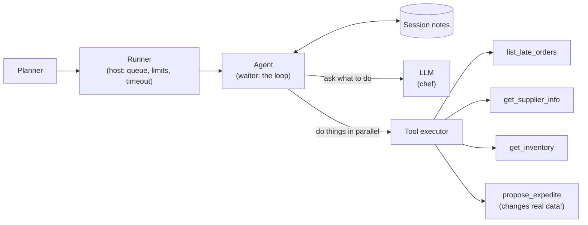
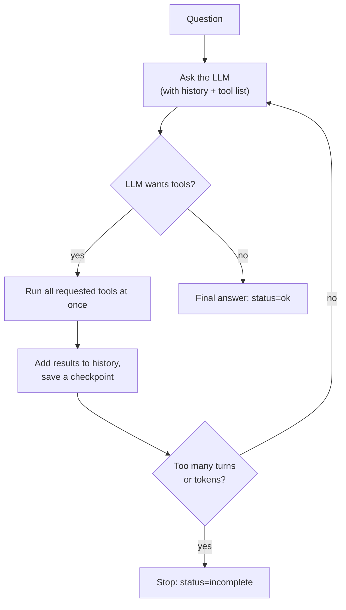

# po-agent: a reliable AI agent for late purchase orders

An AI agent that answers planners' questions like *"which late purchase orders need attention?"* by calling business tools, and keeps working when things go wrong: many users at once, flaky systems, throttled AI service, duplicate clicks.

It runs **fully offline** (no AWS account needed): a scripted fake LLM stands in for AWS Bedrock, and a real Bedrock adapter is included, ready for when you have credentials.

```bash
make install   # uv sync
make test      # 66 tests, ~1 second
make demo      # 6 concurrent sessions against a backend that fails 30% of the time
```

Documents: [SPEC.md](SPEC.md) (what and why) | [ARCHITECTURE.md](ARCHITECTURE.md) (how) | [THREAT_MODEL.md](THREAT_MODEL.md) (STRIDE security review) | this README (the explanation).

---

## 1. Analogies

### The agent is a restaurant

| In the restaurant | In the code |
|---|---|
| A customer places an order | A planner submits a `TriageRequest` |
| The **host** at the door: limited tables, a short waiting line, "sorry, we're full tonight" | `SessionRunner`: N concurrent sessions, a bounded queue, **load shedding** |
| The **waiter** who talks to the kitchen and to you, decides the next step | `TriageAgent`, the loop |
| The **chef** (smart, but occasionally overwhelmed) | The LLM (Bedrock). Sometimes says "too busy" = *throttling* |
| **Stations** (grill, fryer, dessert), each with its own cooks | **Bulkheads**: a separate pool per tool, so a slow grill doesn't block dessert |
| The **order ticket** with a number | The **idempotency key**: if the waiter submits the same ticket twice, the kitchen cooks one dish |
| The waiter's **notepad per table** | `SessionStore`: each table's state is written down, so no mixing up tables and any waiter can take over |
| Kitchen says "fryer's broken" so you stop sending fries for 10 minutes | **Circuit breaker** |
| "Don't all re-ask at the same second" | **Backoff with jitter** |
| A limit on how many times you may re-ask per hour | **Retry budget** |
| A pre-made batch of sauce used for many dishes | **Cache** for read-only lookups |
| The kitchen display with timestamps and ticket numbers | **Structured logs + trace IDs + metrics** |

### Other quick analogies

- **Idempotency** = an elevator button. Pressing it five times still calls one elevator.
- **Circuit breaker** = a home fuse box. Better to cut the power to one broken appliance than burn the house down.
- **Exponential backoff + jitter** = after a missed call, you wait a bit, then longer, and you pick a *random* moment so everyone isn't redialling at 12:00:00.
- **Token bucket** = a bucket of tickets refilled at a steady rate. No ticket, you wait. It keeps you under the speed limit before the police (Bedrock) pull you over.

---

## 2. Diagrams

### The big picture



### The agent loop



### What happens when a call fails

```
call a tool
  |-- succeeded ------------------------------> use the result
  |-- "bad input / unknown id" (permanent) ---> tell the LLM, don't retry
  |-- "503 / timeout" (transient) ------------> wait random(0..cap), cap doubles each time
  |                                             retry, up to 4 attempts
  |                                             (stop early if circuit open or retry budget empty)
  `-- still failing -------------------------> tell the LLM "this data is unavailable"
                                                 -> the answer says "unknown", never invents
```

---

## 3. An example

A planner asks: **"Which late POs need attention?"**

The stub data (5 late POs) includes PO-1001, 12 days late, with only 2 days of stock left.

1. **Runner** has a free slot and starts the session. Every log line from now on carries `request_id=req-0` and a `trace_id`.
2. **Agent -> LLM**: "Here's the question and the tools."  LLM: *"Call `list_late_orders`."*
3. **Tool** returns 5 POs. **LLM**: *"Call `get_inventory` for each SKU and `get_supplier_info` for each supplier"*, 8 calls, run **at the same time**.
4. The backend flakes on a couple of calls. The log shows the system handling it:
   ```json
   {"level":"WARNING","logger":"po_agent.retry","event":"retry_scheduled","request_id":"req-0","trace_id":"484360570e684fc5","op":"tool:get_inventory","attempt":1,"delay_s":0.083,"error":"get_inventory: simulated 503 from backend"}
   ```
   Waits 83 ms (a random value in 0..200 ms), retries, succeeds.
5. **LLM** sees PO-1001 and PO-1003 have under 5 days of stock: *"Call `propose_expedite` for both."* Each gets an idempotency key. If this call were retried or the same request were submitted twice, the supplier would still get **one** request.
6. **LLM** writes the final answer (`status=ok`):
   ```
   [CRITICAL] PO-1001 (Acme Metals): only 2.0 days of stock -> expedite requested
   [CRITICAL] PO-1003 (Acme Metals): only 3.0 days of stock -> expedite requested
   [WARNING]  PO-1004 (Cobalt Ltd): 15 days late, stock ok (30 days)
   [LOW]      PO-1002 (Bolt & Co): 3 days late, stock ok (30 days)
   [LOW]      PO-1005 (Bolt & Co): 1 days late, stock ok (5 days)
   ```
7. Try the duplicate: `uv run python -m po_agent --sessions 6 --duplicate` submits `req-0` twice at once. The last line says `expedite side effects actually performed: 12` = 6 requests x 2 POs, **not 14**.

**What if the inventory system is really down?** After 5 straight failures the circuit opens; `get_inventory` calls fail instantly instead of piling up. The LLM can't see stock, so the answer marks those POs `UNKNOWN` and does **not** expedite anything. Degrading honestly beats guessing. (You can see this with `--failure-rate 0.3`; the number of expedites varies from run to run because of it.)

---

## 4. Plain-language explanation

**What does it do?** It reads your question, looks up late orders, checks how much stock is left and how reliable the supplier is, flags the dangerous ones, and (for the really urgent ones) asks the supplier to rush the order.

**What is an "agent"?** A normal program follows fixed steps. An agent hands the *decisions* to an AI: the program shows the AI a menu of tools, the AI picks what to call, the program runs it and shows the AI the results, and this repeats until the AI says "done". Our code is the safe wrapper around that loop.

**Why is it mostly about reliability?** Calling an AI and several business systems is like depending on several unreliable friends. Real life brings: the AI saying "slow down" (throttling), a system timing out, ten planners asking at once, someone double-clicking "Expedite". Without protection you get crashes, duplicate supplier requests, runaway cloud bills, and one bad session hurting everyone.

**The protections, in one line each**
- *Retries with backoff + jitter*: try again, but politely and at random times.
- *Rate limiter*: never ask the AI faster than we're allowed.
- *Circuit breaker*: stop calling something that is clearly broken.
- *Retry budget*: don't let retries snowball into a stampede.
- *Queue + load shedding*: when overloaded, say "busy" quickly instead of failing slowly.
- *Idempotency keys*: doing a write twice has the same effect as once.
- *Session store*: each conversation's notes are kept separately, outside the agent, so they can't mix and can be resumed.
- *Limits (turns, tokens, timeouts)*: a confused AI can't loop forever or burn money.
- *Bulkheads + cache*: one slow tool can't block others; repeated lookups are free.
- *Logs, trace IDs, metrics, evals*: you can see what happened and notice when behaviour regresses.

**What is fake right now?** The AI (a scripted stand-in that follows the same protocol), the business systems (in-memory data), and the storage (in memory). All sit behind interfaces so the real ones plug in later. The Bedrock adapter is written and unit-tested against a fake client but has **never talked to real AWS**.

---

## 5. Technical description

### Layout

```
src/po_agent/
  runner.py         admission control: semaphore, bounded queue, shed, session timeout
  agent.py          loop, max_turns, token budget, checkpoints, replay
  retry.py          backoff + full jitter; composes limiter/breaker/budget/timeout
  resilience.py     TokenBucket, CircuitBreaker, RetryBudget
  idempotency.py    IdempotencyStore protocol + in-memory single-flight implementation
  cache.py          TTL cache with single-flight (read-only tools)
  session_store.py  SessionStore protocol + in-memory implementation
  tools/            registry (schema validation), executor, tool definitions, stub backend
  llm/              LLMClient protocol, FakeLLM, BedrockLLM (Converse API)
  logging.py        JSON logs + ContextVar context (request_id, trace_id)
  metrics.py        counters + timings with p95
  config.py         Settings: every limit in one dataclass
tests/              66 tests incl. evals/cases.json regression scenarios
```

### Key contracts

- `LLMClient.complete(system, messages, tools) -> LLMResponse`. Must raise `TransientError` / `PermanentError`.
- `Tool = ToolSpec(name, description, input_schema, side_effecting, cache_ttl_s) + async handler(args, ctx)`.
  Write tools are flagged `side_effecting=True` and receive `ctx.idempotency_key`; pass it to the backend.
- `ToolExecutor.execute()` never raises; failures are `ToolResult(is_error=True, content={error, message, retryable})`.
- `SessionRunner.handle()` never raises; always returns a `TriageResponse` (`ok|incomplete|failed|timeout|shed`).

### Defaults (`Settings`)

| Knob | Default | Protects against |
|---|---|---|
| `max_concurrent_sessions` / `max_queue_depth` | 8 / 32 | overload |
| `session_timeout_s` | 30 | stuck sessions |
| `max_turns` / `max_tokens_per_session` | 8 / 20 000 | runaway loops and cost |
| `llm_requests_per_s` / `llm_burst` | 20 / 20 | Bedrock throttling (set below your quota) |
| `llm_timeout_s` / `tool_timeout_s` | 20 / 5 | slow dependencies |
| `retry` | 4 attempts, base 0.2 s, cap 5 s | transient errors |
| `breaker_failure_threshold` / `breaker_reset_s` | 5 / 10 | retry storms |
| `default_tool_concurrency` | 8 per tool | slow tool starving others |

### Using real Bedrock later

```python
from po_agent.llm.bedrock import BedrockLLM

llm = BedrockLLM(
    model_id="<a model/inference-profile id enabled in your account>", region="us-east-1"
)
agent = TriageAgent(llm, executor, settings)  # nothing else changes
```
Needs `uv sync --extra bedrock`, AWS credentials, and model access enabled in the Bedrock console. The adapter builds its own boto3 client with boto's retries turned off (our retry layer is the only one), socket timeouts, and a thread/connection pool sized to `max_concurrency`; see ARCHITECTURE.md section 8a.

### Extending

- **New tool**: add a `Tool(ToolSpec(...), handler)` in `tools/po_tools.py`. Writes: set `side_effecting=True`. Reads: optionally set `cache_ttl_s`.
- **Real backend**: replace `StubBackend` methods with real clients that raise `TransientError`/`PermanentError`.
- **Durable state**: implement `SessionStore` / `IdempotencyStore` over DynamoDB or Redis (see ARCHITECTURE.md section 9).

### Testing

`make test` runs everything offline. Notable tests: parallel duplicate writes execute once; a "write committed but reply lost" retry does not duplicate; 20 requests vs 2 workers + queue of 3 gives 15 shed; resubmitting after a timeout resumes and still performs each write once; 40 concurrent sessions never see each other's history; Bedrock request/response mapping and error classification.

### Known gaps

Per-process (not distributed) limiter/breaker/budget; no authentication (the API layer must supply a verified `planner_id`) and the default authorizer allows everything (see THREAT_MODEL.md); in-memory stores; metrics are not exported; Bedrock path unverified against real AWS; no API server in front. See SPEC.md section 8.
